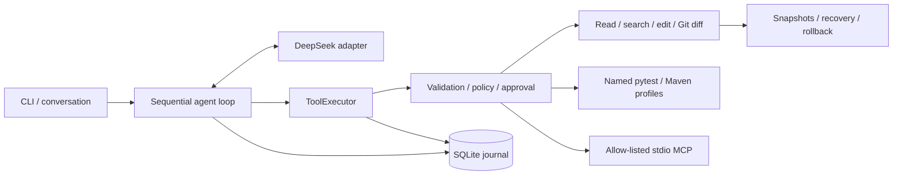

# VeriTrail

**Inspect with evidence. Change with approval. Recover with context.**

[English](README.md) · [简体中文](README.zh-CN.md)

[](https://github.com/spylent-1/veritrail-agent/actions/workflows/ci.yml)
[](https://www.python.org/downloads/)
[](LICENSE)

An auditable coding agent CLI with approval-gated edits, test verification, persistent sessions, and recoverable workflows.

VeriTrail connects a sequential agent loop to your trusted Java or Python repository. It can trace source, propose focused edits, run named test profiles, and continue saved conversations. Every model-requested action goes through one tool executor; SQLite records the messages, approvals, and outcomes needed to inspect what happened.

## Why VeriTrail

| Capability | Engineering behind it |
| --- | --- |
| **Controlled execution** | Read-only by default; edit, test, MCP startup and MCP calls require concrete approvals. No general shell tool. |
| **Source-backed answers** | File evidence carries paths, returned line ranges and SHA-256 hashes. Truncated previews cannot claim unseen complete lines. |
| **Verification that stays current** | Test status comes from process results and fresh JUnit reports. Every successful agent write invalidates earlier verification. |
| **Durable sessions** | SQLite is the authoritative journal; JSONL traces are derived exports. Continuing a session never reuses approvals or read grants. |
| **Recoverable changes** | Exact-match edits, hash checks, atomic single-file writes and snapshots support conflict-aware recovery and rollback. |
| **Explicit integrations** | DeepSeek provider adapter, host-defined pytest/Maven profiles and allow-listed stdio MCP tools share the execution boundary. |

## Architecture



The orchestration loop, tool protocol, approval binding, journal and recovery flow are implemented in this repository. Model SDK handling stays in the provider adapter; terminal interaction stays at the CLI boundary. See [architecture](docs/architecture.md) for the concrete call chain and tradeoffs.

## Quick start

Requirements: **Python 3.12**, **Git**, and **ripgrep** (`rg`) on PATH. Java tests also require **JDK 17** and **Maven**.

```sh
git clone https://github.com/spylent-1/veritrail-agent.git
cd veritrail-agent
python -m pip install --user uv
python -m uv sync --locked
python -m uv run veritrail doctor
```

Set the key in the host environment:

```powershell
# PowerShell
$env:DEEPSEEK_API_KEY = "<your API key>"
python -m uv run veritrail chat --workspace D:\YourRepo
```

```sh
# bash / zsh
export DEEPSEEK_API_KEY="<your API key>"
python -m uv run veritrail chat --workspace /path/to/your/repo
```

`doctor` checks local configuration without calling a model. `chat` and `run` make paid model API calls. Repository `.env` files are never loaded; `.env.example` documents the host variables only.

### From inspection to verified edits

```sh
# Read-only source investigation
python -m uv run veritrail run "Trace the coupon claim flow; cite source lines" --workspace /path/to/repo

# Interactive editing: each concrete edit and test still requires approval
python -m uv run veritrail chat --workspace /path/to/repo --mode edit

# Inspect saved work and continue a conversation
python -m uv run veritrail sessions
python -m uv run veritrail chat --session <session-id>
python -m uv run veritrail trace <run-id> --jsonl
python -m uv run veritrail rollback <run-id>
```

In chat, `/help` lists commands, `/new` starts a fresh session with the same workspace and mode, and `/exit` closes it. Ctrl+C cancels the current task and exits chat. Continuing a session inspects saved state and does not replay interrupted side effects.

Configure named test profiles in the **host** file `~/.repopilot/config.toml`; adapt the absolute executable paths in [the example](docs/config.example.toml). The model selects a profile name, never a shell command. MCP also requires a host configuration and explicit `--mcp <name>` selection; see [integration setup](docs/architecture.md#mcp-setup).

### Compatibility

VeriTrail was previously named RepoPilot. The distribution is now `veritrail-agent`; `veritrail` is the primary command and `repopilot` remains an alias. The internal `repopilot` module, `~/.repopilot` data directory and `REPOPILOT_HOME` variable remain compatible with existing sessions. Installation is currently from source or a locally built wheel; no PyPI release is claimed.

## Validation

**145 local tests passed** after the reliability fixes and metadata-diff regression, covering ScriptedFake model flows and real Git, pytest, Maven and MCP subprocesses on Windows. Ruff, formatting, mypy and package builds are separate quality gates. The [Actions badge](https://github.com/spylent-1/veritrail-agent/actions/workflows/ci.yml) shows current Windows/Ubuntu CI status; see the [validation record](docs/validation.md) for the tested source revision and installation checks.

Historical real-model evaluation on commit `095e402` used 12 fixed Java/Python tasks, repeated three times:

| Task category | Strict passes | Runs |
| --- | ---: | ---: |
| Source localization with checked citations | 15 | 18 |
| Code repair with independent acceptance checks | 18 | 18 |

These are small-fixture results for that historical commit, not a benchmark of the current revision or large production repositories. The original [benchmark summary](docs/validation/benchmark.json) is preserved unchanged. No new paid model evaluation is included in the VeriTrail publication checks.

### Run the quality gates

```sh
python -m uv run pytest
python -m uv run ruff check .
python -m uv run ruff format --check .
python -m uv run mypy
python -m uv build
git diff --check
```

Tests require no model credentials. Maven may download fixture dependencies on the first run. The optional real-model evaluation is documented separately in the [validation guide](docs/validation.md#reproducing-evaluations).

## Trust boundaries

Use VeriTrail with repositories you trust. Test code, build plugins and MCP servers run with your user permissions; approval controls are not an OS sandbox. Allowed source content may be sent to the configured model provider. Credential filtering is bounded, and snapshots contain original source bytes. Verification describes the agent's observed test run; external file changes still require inspection and another test run. Read the [security model](docs/security.md) before enabling edits or integrations.

This release focuses on a single sequential agent. RAG, long-term memory, Skills, parallel agents and unrestricted shell execution are outside its scope.

## Documentation

| Guide | English | 简体中文 |
| --- | --- | --- |
| Architecture and MCP setup | [Architecture](docs/architecture.md) | [架构](docs/zh-CN/architecture.md) |
| Trust and security boundaries | [Security](docs/security.md) | [信任边界](docs/zh-CN/security.md) |
| Validation and evidence | [Validation](docs/validation.md) | [验收记录](docs/zh-CN/validation.md) |

[Development history (中文)](docs/progress.md) · [Source-reading exercises (中文)](docs/learning.md) · [Publication checklist (中文)](docs/release-checklist.md)

## Contributing

Want to contribute? See the [contribution guide](CONTRIBUTING.md) for setup, checks and pull request guidance.

## License

[MIT](LICENSE) © 2026 spylent-1.
