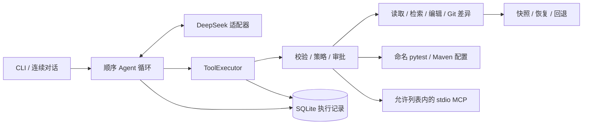

# VeriTrail

**以证据理解源码，以审批控制修改，以记录支持恢复。**

[English](README.md) · [简体中文](README.zh-CN.md)

[](https://github.com/spylent-1/veritrail-agent/actions/workflows/ci.yml)
[](https://www.python.org/downloads/)
[](LICENSE)

支持逐项审批、测试验证、持久会话与恢复回退的可审计编码智能体 CLI。

VeriTrail 将顺序 Agent 循环连接到你信任的 Java 或 Python 仓库，支持追踪源码、提出局部修改、运行命名测试配置和继续已有对话。所有模型请求的操作统一经过工具执行器；SQLite 保存消息、审批与结果，便于检查实际执行过程。

## 工程亮点

| 能力 | 实现方式 |
| --- | --- |
| **可控执行** | 默认只读；编辑、测试、MCP 启动与调用逐次审批，不提供自由 Shell 工具。 |
| **源码证据** | 文件引用包含路径、实际返回行范围和 SHA-256；截断预览不能引用未返回的完整行。 |
| **验证状态更新** | 结合进程结果与新鲜 JUnit 报告判定测试状态；每次成功写入都会使旧验证失效。 |
| **持久会话** | SQLite 是唯一权威记录，JSONL 从记录导出；继续会话不复用审批和读取授权。 |
| **恢复与回退** | 精确匹配、哈希检查、单文件原子写入与快照，支持冲突保护恢复和回退。 |
| **显式集成** | DeepSeek 适配器、宿主 pytest/Maven 配置和允许列表内的 stdio MCP 共用执行边界。 |

## 架构



Agent 循环、工具协议、审批绑定、记录与恢复流程均在本仓库实现。模型 SDK 封装在 Provider 适配器中，终端交互保留在 CLI 边界。具体调用链和设计取舍见 [架构文档](docs/zh-CN/architecture.md)。

## 快速开始

需要 **Python 3.12**、**Git** 和 **ripgrep**（`rg`），并加入 PATH。Java 测试还需要 **JDK 17** 与 **Maven**。

```sh
git clone https://github.com/spylent-1/veritrail-agent.git
cd veritrail-agent
python -m pip install --user uv
python -m uv sync --locked
python -m uv run veritrail doctor
```

在宿主环境中设置密钥：

```powershell
# PowerShell
$env:DEEPSEEK_API_KEY = "<你的 API Key>"
python -m uv run veritrail chat --workspace D:\YourRepo
```

```sh
# bash / zsh
export DEEPSEEK_API_KEY="<你的 API Key>"
python -m uv run veritrail chat --workspace /path/to/your/repo
```

`doctor` 只检查本地配置，不调用模型。`chat` 和 `run` 会调用付费模型 API。项目不会加载目标仓库的 `.env`；`.env.example` 仅说明宿主环境变量。

### 从源码定位到验证修改

```sh
# 只读追踪源码
python -m uv run veritrail run "追踪优惠券领取调用链，引用源码行号" --workspace /path/to/repo

# 交互编辑：每次具体修改和测试仍需审批
python -m uv run veritrail chat --workspace /path/to/repo --mode edit

# 查看记录并继续会话
python -m uv run veritrail sessions
python -m uv run veritrail chat --session <session-id>
python -m uv run veritrail trace <run-id> --jsonl
python -m uv run veritrail rollback <run-id>
```

对话内使用 `/help` 查看命令，`/new` 保留工作区和模式并开始新会话，`/exit` 退出。Ctrl+C 取消当前任务并结束对话。继续会话会检查保存状态，不自动重放被中断的副作用。

测试配置写在**宿主** `~/.repopilot/config.toml`，参考 [配置示例](docs/config.example.toml) 并修改绝对可执行文件路径。模型只能选择配置名，不能提交 Shell 命令。MCP 同样需要宿主配置和显式 `--mcp <name>` 选择，见 [MCP 配置](docs/zh-CN/architecture.md#mcp-配置)。

### 兼容性

项目原名 RepoPilot。分发包现名 `veritrail-agent`，主命令为 `veritrail`，保留 `repopilot` 兼容入口。内部 `repopilot` 模块、`~/.repopilot` 目录和 `REPOPILOT_HOME` 环境变量继续兼容已有会话。目前通过源码或本地 wheel 安装，尚未发布到 PyPI。

## 验证结果

可信度修复及 Git 元数据回归后，**本地 145 项测试通过**，覆盖 ScriptedFake 模型流程，以及 Windows 上真实 Git、pytest、Maven 和 MCP 子进程。Ruff、格式、mypy 与构建分别验收。[Actions 徽章](https://github.com/spylent-1/veritrail-agent/actions/workflows/ci.yml) 展示当前 Windows/Ubuntu CI 状态；测试来源版本和安装检查见 [验收记录](docs/zh-CN/validation.md)。

历史真实模型评测基于提交 `095e402`，使用 12 个固定 Java/Python 任务，每项重复三次：

| 任务类型 | 严格通过 | 运行次数 |
| --- | ---: | ---: |
| 源码定位与引用检查 | 15 | 18 |
| 代码修复与独立验收 | 18 | 18 |

这些是历史提交的小型样例结果，不代表当前版本重测或大型生产仓库能力。原始 [评测摘要](docs/validation/benchmark.json) 保持不变。本次 VeriTrail 发布检查未新增付费模型评测。

### 运行质量门禁

```sh
python -m uv run pytest
python -m uv run ruff check .
python -m uv run ruff format --check .
python -m uv run mypy
python -m uv build
git diff --check
```

测试不需要模型凭证。首次 Maven 测试可能下载夹具依赖。可选的真实模型评测另见 [评测说明](docs/zh-CN/validation.md#复现评测)。

## 信任边界

请用于你信任的仓库。测试代码、构建插件与 MCP Server 使用宿主用户权限运行，审批控制并非操作系统沙箱。允许读取的源码可能发送给配置的模型服务；凭证过滤存在边界，快照保存原始源码字节。验证状态描述 Agent 已观察到的测试运行，外部文件修改仍需检查并重新测试。启用编辑和集成前请阅读 [信任边界](docs/zh-CN/security.md)。

本版本聚焦单个顺序 Agent；RAG、长期记忆、Skills、并行 Agent 和自由 Shell 不在本次范围内。

## 文档

| 内容 | English | 简体中文 |
| --- | --- | --- |
| 架构与 MCP 配置 | [Architecture](docs/architecture.md) | [架构](docs/zh-CN/architecture.md) |
| 安全与信任边界 | [Security](docs/security.md) | [信任边界](docs/zh-CN/security.md) |
| 验证与证据 | [Validation](docs/validation.md) | [验收记录](docs/zh-CN/validation.md) |

[开发记录（中文）](docs/progress.md) · [源码阅读练习（中文）](docs/learning.md) · [发布检查（中文）](docs/release-checklist.md)

## 许可证

[MIT](LICENSE) © 2026 spylent-1。
