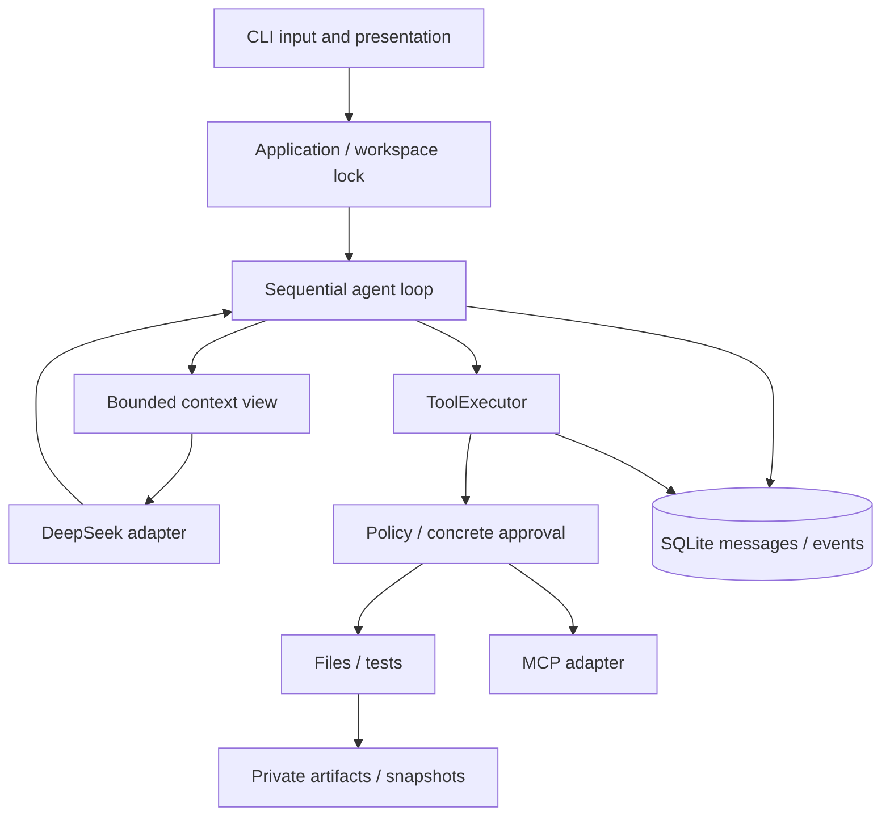

# Architecture

English · [简体中文](zh-CN/architecture.md)

## One execution boundary

`cli.run → application.run_task → AgentRunner.run → ContextBuilder.build → DeepSeekProvider.complete`

Structured tool requests follow:
`ToolExecutor.execute → argument validation → PolicyEngine → prepare → user approval → SQLite tool_intent → commit → ToolResult paired by tool_call_id`.



## Three different outcomes

- `status=completed`: the model finished its answer; this does not establish correctness.
- `verification=passed`: a test process and fresh JUnit reports established a passing run. Every successful agent write clears earlier verification. External changes are not continuously monitored.
- Independent evaluation `passed=true`: an external grader accepted the resulting code or checked localization citations against paths, lines and current hashes.

Default budgets are 20 model responses, 40 tool calls and 15 minutes of active execution. Approval waiting is excluded. Model calls have separate timeouts; transient provider errors receive at most two extra attempts with SDK retries disabled. ToolExecutor never automatically replays edits, tests or MCP calls.

## Messages, context and persistence

Full messages are stored in SQLite. ContextBuilder creates a view: it first shortens large historical tool bodies, then drops older complete user turns. System constraints, the current task and recent tool groups are retained. Capacity includes tool schemas and measures serialized input bytes, not exact tokens. Provider usage is accumulated separately and marked incomplete when a request or retry has missing usage; it is not an exact billing calculation.

SQLite stores `sessions`, `runs`, `messages`, `events` and `tool_executions`. Messages and their events share a transaction. JSONL is exported from saved events, rather than written as a competing journal. Source snapshots and bounded logs live in the private host state directory.

Recovery inspects unfinished tool groups. A file matching the target hash can establish a completed write; an original hash does not cause replay, and conflicting content stays unknown. Interrupted tests and external calls remain unknown. Session continuation never reuses read grants or approvals.

## Edits and rollback

`edit_file` requires an observed `expected_hash` and uniquely matching old text. Replacement ranges cannot overlap. UTF-8, BOM and LF/CRLF are preserved. After approval, the current hash is checked again before a same-directory temporary file is atomically substituted. `create_file` uses atomic create-if-absent behavior. Snapshots preserve the original bytes, including existing user edits.

Rollback is an explicit host operation routed through ToolExecutor. It validates the reverse edit chain before restoring files and refuses conflicts. Multi-file rollback is not a transaction: a concurrent change can still cause partial completion. Inspect the trace and files after interruption. There is no exactly-once guarantee spanning files, SQLite and subprocesses.

## File evidence and Git state

Reads return complete lines within a 12KB text budget, then create EvidenceRef ranges for those lines. An oversized single line receives a partial preview without a complete-line citation. Empty files have no invented source-line evidence. Incomplete requested ranges do not grant fresh read authorization; use a smaller range before editing.

Git output separates `[staged]`, `[unstaged]` and `[untracked]` changes, including deletions and unborn repositories. Renames appear as deletion plus addition. Historical, index and worktree content all receive path, encoding, size and link checks. A request is bounded to 200 changed paths and 16KiB of diff text; truncation is explicit. Changes can include pre-existing user work.

## MCP lifecycle

The locked MCP SDK manages stdio servers. Only explicitly selected host-configured servers are connected. Startup and each tool call require separate approvals. Tool names use namespaces and short hashes; JSON Schema validates inputs, and unsupported schemas are rejected at registration. Only text and bounded JSON are passed through. Resource links are not automatically fetched. External results are not file EvidenceRef objects.

Legacy protocol negotiation and low-level `session.call_tool` avoid implicit high-level tool retries or input-required replay. Failed connections are disabled rather than automatically reconnected. Local controls do not restrict the server's OS permissions.

## MCP setup

Add a server to the host file `~/.repopilot/config.toml`, replacing the example paths:

```toml
[mcp.docs]
executable = 'D:\path\to\veritrail-agent\.venv\Scripts\python.exe'
args = ['-m', 'repopilot.mcp_sample', '--root', 'D:\path\to\veritrail-agent\docs']
tools = ['get_project_conventions']
timeout = 20
```

Start explicitly with `python -m uv run veritrail chat --mcp docs`. Server startup and calls are approved separately. Repository MCP configuration is never automatically loaded; external servers are not automatically installed. On POSIX, use absolute paths to the installed Python executable and directory.

## Brand compatibility

The distribution is `veritrail-agent`, with `veritrail` as the primary CLI and `repopilot` as an alias. Internal Python imports remain `repopilot`. Host state stays under `~/.repopilot`, honoring `REPOPILOT_HOME`. The SQLite schema is unchanged and existing sessions need no migration.
