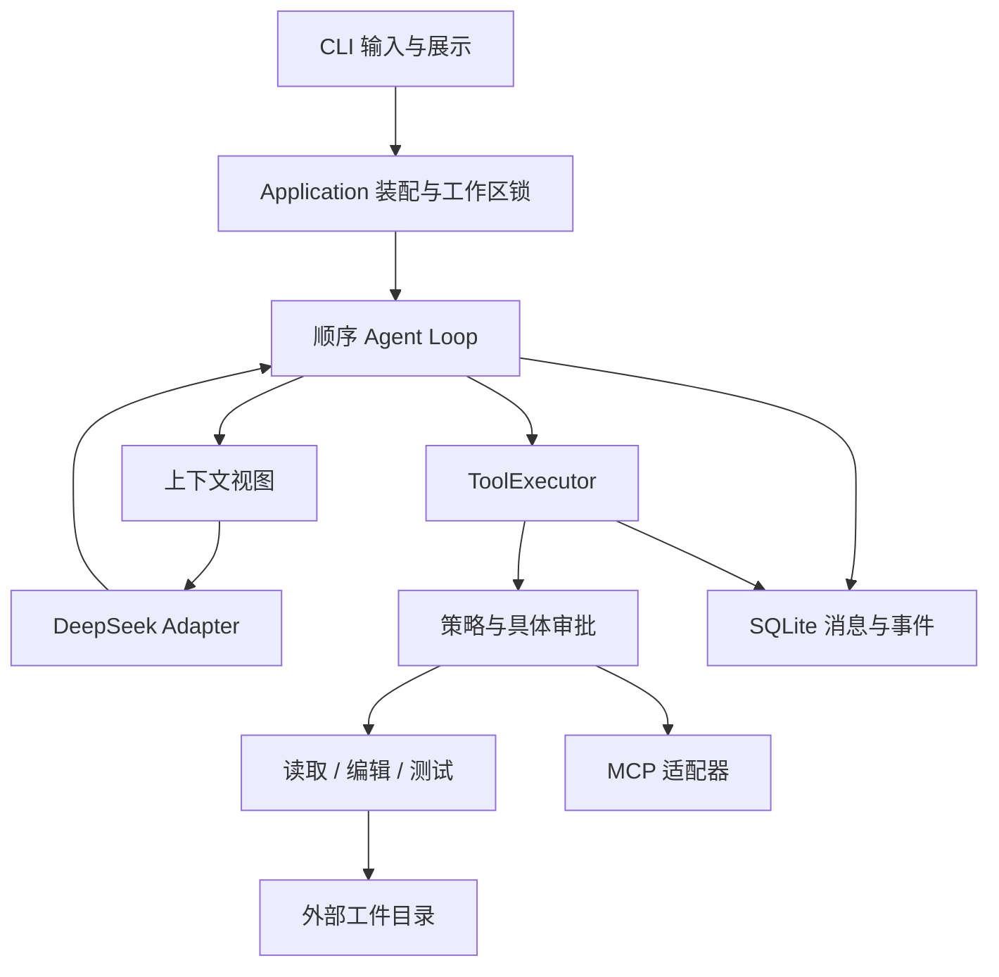

# 调用链与模块边界

[English](../architecture.md) · 简体中文

`cli.run → application.run_task → AgentRunner.run → ContextBuilder.build → DeepSeekProvider.complete`
收到结构化调用后：`ToolExecutor.execute → 参数校验 → PolicyEngine → prepare → 用户审批 →
SQLite tool_intent → commit → ToolResult → tool_call_id 配对回传`。



## 三个需要区分的状态

- `status=completed`：模型完整结束回答；不是业务结果正确的证明。
- `verification=passed`：某次测试进程和新鲜 JUnit 报告都通过；随后再次编辑会清除此状态。
- 独立评测 `passed=true`：代码通过工作区外的验收，或者定位引用通过当前路径/行号/哈希校验。

一次运行默认最多 20 次模型响应、40 次工具调用、15 分钟主动执行。审批等待不计主动时间。
模型请求有独立超时，暂时性错误最多额外重试两次；SDK 的自动重试关闭。
ToolExecutor 不自动重放编辑、测试或 MCP 操作。

## 消息、上下文和持久化

完整 Message 保存到 SQLite；ContextBuilder 创建副本，优先裁剪旧工具的大段正文，随后移除
较早的完整 user 轮次。保留系统约束、当前用户任务和最近工具组。容量计算包含工具 Schema，
限制是序列化输入字节数，不是精确 Token 数。Provider 返回的 usage 单独累计；请求失败或重试
缺少 usage 时标记不完整，不能据此推导账单精确金额。

SQLite 表：sessions、runs、messages、events、tool_executions。消息与对应事件在同一事务中
保存。JSONL 是读取 events 后导出。文件快照和有大小上限的日志保存在宿主状态目录。

恢复检查未完成工具组。文件与目标哈希相同才能确认写入；与原始哈希相同则不重放；其余情况
保持未知。测试和外部调用中断时不猜测结果。继续会话的读取授权和用户审批均不复用。

## 编辑与回退

edit_file 使用 expected_hash 和唯一匹配的旧文本；多个替换必须不重叠。保留 UTF-8/BOM、
LF/CRLF。预览后再次校验当前文件，再写同目录临时文件并替换。create_file 使用原子
create-if-absent。保存的是本轮修改前快照，不依赖整个 Git 工作区是否干净。

rollback 是明确的宿主操作，也经 ToolExecutor 审批和审计。先校验完整逆序修改链，再逐文件
恢复；冲突时拒绝覆盖。多文件操作不是跨文件事务，执行过程中出现新的并发修改仍可能部分
完成，需要检查 Trace 和现场。未承诺跨文件、SQLite 与子进程的 exactly-once 执行。

## MCP

官方 mcp 2.3.0 管理 stdio 进程。只连接显式选择且配置过的 Server，启动和每次调用各自审批。
工具名称带命名空间和短哈希；输入用 jsonschema 校验。不支持的 Schema 直接拒绝注册。
只传文本与受限 JSON，不自动读取 resource links。外部结果不是文件 EvidenceRef。

使用 legacy 协议协商和低层 session.call_tool，避开高层自动工具重试及 input-required 重放。
连接失败后禁用，不自动重连。本地控制不能约束 Server 进程的操作系统权限。


## 文件证据与完整 Git 差异

读取按 12KB 正文预算返回完整行，再按实际返回行生成 EvidenceRef。超长单行只提供部分预览，
不生成完整行引用；空文件不生成虚构行号。请求范围未完整返回时不新增读取授权，可缩小行范围重读。

Git 差异分别展示 `[staged]`、`[unstaged]`、`[untracked]`，包含删除文件和首次提交前的状态；
重命名按删除和新增展示。历史、索引和工作区内容均经过路径、编码、大小及链接检查。
单次最多 200 个变更路径、16KiB 差异正文，截断会明确标记，差异可能包含原有用户修改。

## MCP 配置

将以下内容加入宿主 `~/.repopilot/config.toml`，路径替换为实际安装路径：

```toml
[mcp.docs]
executable = 'D:\path\to\veritrail-agent\.venv\Scripts\python.exe'
args = ['-m', 'repopilot.mcp_sample', '--root', 'D:\path\to\veritrail-agent\docs']
tools = ['get_project_conventions']
timeout = 20
```

然后显式运行 `python -m uv run veritrail chat --mcp docs`。Server 启动和工具调用分别审批。
不自动加载目标仓库的 MCP 配置或安装外部 Server。POSIX 环境请使用实际 Python 可执行文件及目录的绝对路径。

## 品牌兼容

分发包为 `veritrail-agent`，主命令为 `veritrail`；`repopilot` 命令和内部 Python 模块保留。
宿主目录仍是 `~/.repopilot`，支持 `REPOPILOT_HOME`，SQLite schema 保持兼容，无需迁移旧会话。
